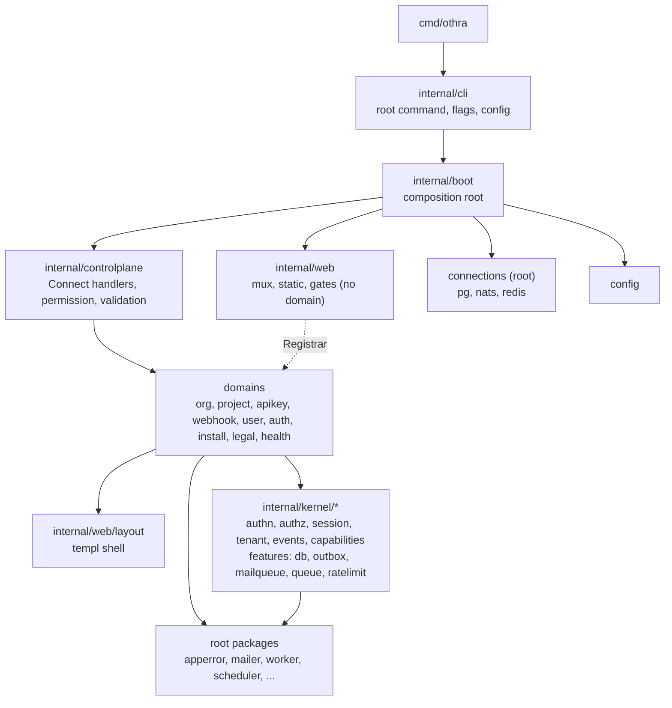

# Architecture

Othra is Altalune's OAuth 2.1 and OpenID Connect identity provider. This milestone is the platform base: orgs, projects, members, API keys, webhooks, the admin console, CLI and MCP. One Go binary (`othra`, module `github.com/altalune-id/othra`) serves every surface from one set of domain services and one Postgres database.

For step-by-step changes, see the recipes in [docs/howto](../howto/README.md).

## Surfaces

| Surface           | Where                                 | Code                                                                  |
| ----------------- | ------------------------------------- | --------------------------------------------------------------------- |
| API               | `/api` (Connect RPC, OpenAPI docs)    | `internal/controlplane`, protos in `api/`                             |
| Portal API        | `/p/<handle>/api/` (`account.v1`)     | `internal/controlplane/account.go` + each domain's `controlplane.go`  |
| MCP server        | `/mcp` (HTTP) and `othra mcp` (stdio) | generated tools over the Connect handlers, `internal/mcp`, root `mcp` |
| CLI               | `othra ...`                           | `internal/cli` (shell) + each domain's `cli.go`                       |
| Web console       | `/console`                            | Nuxt SPA in `ui/console`, embedded by `internal/web/console`          |
| Pre-sign-in pages | `/login`, `/install`, `/invite`, ...  | each domain's `web.go` + templ in `<domain>/views`                    |
| Probes            | `/healthz`, `/readyz`                 | `internal/health`                                                     |

Every signed-in surface (API, MCP, console, the end-user portal) reaches a domain through the `controlplane` handlers, which hold the permission and reach checks. The portal's caller is an end user (`session.EndUser`, the browser's active account), checked against `permission.EndUserTable()`; admin callers are a `session.Principal` checked against `permission.Table()`. Only pre-sign-in pages, operator commands that boot the `App`, and workers call services directly.

## Layers

Import direction: `cmd` → `internal/cli` → `internal/boot` → `internal/controlplane` → domains → `internal/kernel/*`. Domains never import `internal/cli`, `internal/boot`, `internal/controlplane` or `internal/web` (only `internal/web/layout` and `internal/web/i18n`, the hosted pages' copy). Kernel packages import no domain (depguard `kernel-boundary` in `.golangci.yml`). Kernel packages and connections never import `config` (`config-boundary`): each takes its own `Config` from its `config.go`, and boot maps the app config into it.

## Boot

`internal/boot` turns `config.Config` into a running `App`: it opens the database, builds every service once, wires the surfaces and starts the workers. The order, request flow, service wiring, rate limits, Redis, NATS, the queue and workers are in [internal/boot/README.md](../../internal/boot/README.md).

## Kernel

`internal/kernel` holds what services use. It imports no domain. Two kinds of package live there.

The app core:

- `authn`, `authz`: who the caller is, and what they may do.
- `session`: the `Principal` and the browser session store (memory and Postgres stores in-package).
- `tenant`: the org, project and user on the request.
- `events`: the webhook event catalog.
- `capabilities`: the feature switches derived from the deployment mode.

The features, each picking its backend with a `driver` key:

- `db` (`db.driver: postgres`): the writer/reader `Pool`, the unit of work (`RunInTx`, `InTx`, `LockInTx`) and the Postgres error checks (`IsUniqueViolation`, `IsForeignKeyViolation`, `ViolatedConstraint`), so domains never import the driver.
- `outbox`, `mailqueue`: durable delivery (webhooks, mail). They commit in the same transaction as the domain change, so they keep their Postgres store in-package and have no driver switch.
- `queue` (`queue.driver: nats`): jobs and broadcasts, driver-agnostic; its NATS JetStream driver is `queue/nats`.
- `ratelimit` (`rateLimit.driver: memory|redis`): GCRA limits, with `ratelimit/memory` and `ratelimit/redis` drivers and the shared contract in `ratelimit/ratelimittest`.

## Connections

The root packages `pg`, `nats` and `redis` each open, health-check and close one backend, then return the real client (`*sql.DB`, `*nats.Conn`, the go-redis client) without wrapping its API. Their config is a top-level key (`postgres.*`, `nats.*`, `redis.*`) mapped by boot into the package's own `Config`. Boot opens a connection only when a feature selects it (`PostgresFeatures`, `NATSFeatures`, `RedisFeatures`), hands it to the feature, and closes it on shutdown; `/readyz` reads each one's health monitor.

Only the connection, its drivers, boot and the test helpers import a backend library (depguard `pgx-boundary`, `nats-boundary`, `redis-boundary`). Domains never import `pg`, `nats` or `redis`.

## Domains

Each domain is a package under `internal/`: `org` (with `org/member` and `org/invite`), `project`, `apikey`, `webhook`, `user`, `auth`, `install`, `legal`, `health`. Each uses only the files it needs: `<domain>.go`, `errors.go`, `ports.go`, `store.go` + `pg*.go`, `service.go`, then one file per surface (`controlplane.go`, `cli.go`, `web.go`), with templ views in `<domain>/views`. See [module.md](../howto/module.md).

Other internal packages: `permission` (the permission each RPC needs), `apiclient` (the CLI's Connect client), `prompt` (stdin prompts), `render` (CLI output), `mcp` (MCP auth and payloads).

## Root packages

Packages at the repo root never import `internal/`: `apperror` (error codes, `codes.json`), `config`, the connections `pg`, `nats` and `redis`, `migrator`, `mailer` (+ console, smtp, resend), `worker`, `scheduler`, `httpclient`, `httpserver`, `mcp`, `password`, `sealer`, `nanoid`, `slug`, `scope`, `reqid`, `telemetry`, `version`.

## Library modules

`oidcrp` (an OpenID Connect relying party) and `oauthrs` (an OAuth resource server) live in their own repos, [`github.com/altalune-id/oidcrp`](https://github.com/altalune-id/oidcrp) and [`github.com/altalune-id/oauthrs`](https://github.com/altalune-id/oauthrs), so apps import them without the server. They use only the standard library, go-jose and, for `oauthrs`, `oidcrp`.

- Othra uses them like any app: the console sign-in and federation through `oidcrp`, resource-server verification through `oauthrs`.
- Until they are tagged, `go.mod` pins a commit (a pseudo-version); bump it with `go get github.com/altalune-id/oidcrp@<commit>`.
- A change to a library lands in its repo first, then Othra and the apps bump to it.

## UI builds

The pnpm workspace under `ui/` (packages listed in `pnpm-workspace.yaml`) builds assets that the binary embeds. The builds are not committed.

| Package      | What                           | Build             | Embedded at                   |
| ------------ | ------------------------------ | ----------------- | ----------------------------- |
| `ui/console` | Nuxt 4 console SPA             | `make ui-console` | `internal/web/console/public` |
| `ui/mcp`     | MCP Apps view                  | `make ui-mcp`     | `internal/mcp/ui/assets`      |
| `ui/web`     | Tailwind CSS + password script | `make web`        | `internal/web/static`         |

Every surface shares one look: `ui/theme.css` holds the daisyUI themes, and `ui/base` (a Nuxt layer) holds the shared components. `ui/mcp` is plain Vite + Vue in a sandboxed iframe, so it imports `ui/base/app/components/ui/*` source directly (the `@othra/base` workspace dev dependency and `baseAliases`) and registers the two Nuxt globals those components use with `installStandalone`. A test keeps `components/ui` free of Nuxt composables, and the MCP build inlines only the icons its sources name.

`make ui` builds all three. `ui/scripts/compress.mts` (package `@othra/scripts`) then writes a `.br` and `.gz` next to each console and sign-in text file over 1 KiB. See [console-page.md](../howto/console-page.md) and [web-page.md](../howto/web-page.md).

## Data

Postgres only (`db.driver: postgres`, connection `postgres.*`). Migrations live in `schema/migrations` and run through `migrator` (at boot with `db.autoMigrate`, on `postgres.migrator.dsn` when set). Tables, keys and constraints are in [schema/README.md](../../schema/README.md). See [migration.md](../howto/migration.md).

## Code generation and dev tools

- `make generate`: protos (Go, Connect, OpenAPI, MCP tools, TypeScript in `ui/base/gen`), scope names, error codes and templ.
- `cmd/*`: the generators and linters (`gen-apperror`, `gen-scope`, `gen-config-example`, `protoc-gen-mcp`, `comment-lint`). `protoc-gen-mcp` and `comment-lint` keep their code in `internal/tool` (`protocmcp`, `commentlint`).
- `make check`: vet, lint and tests.
