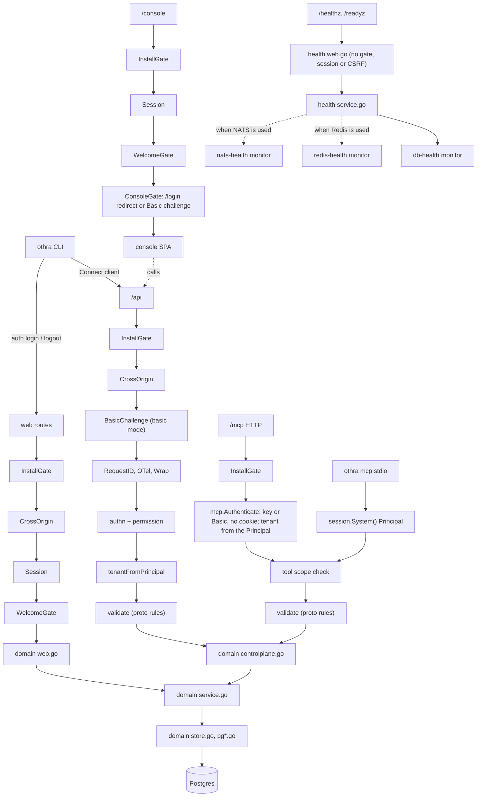
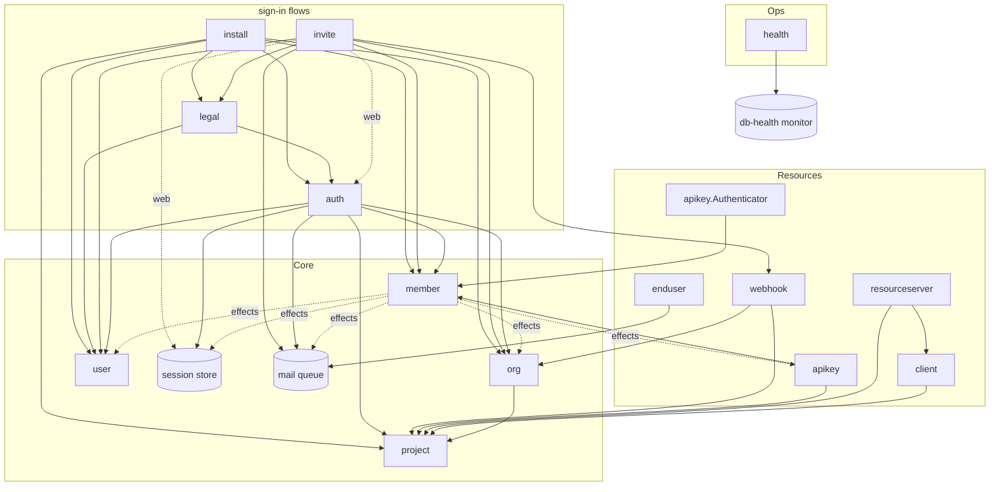

# boot

`boot` is the composition root. It turns `config.Config` into a running app:
it opens the database, builds every domain service, wires the surfaces onto
them and starts the workers. No other package wires domains together.

Keep this file in step with the code. When a domain, surface or worker is
added or removed, update the diagrams and the tables below in the same commit.

## Boot order

`Boot` (`boot.go`) runs these steps in order. Any error stops the boot.

```mermaid
flowchart TD
    A[setupTelemetry] --> B["openDB: db.driver postgres opens the writer and the optional reader"]
    B --> C{db.autoMigrate?}
    C -- yes --> D[migrate]
    C -- no --> RG
    D --> RG["guardRLS: refuse a pool that row-level security would not hold"]
    RG --> E[kernel: log, pool, tracer, meter, reporter]
    E --> NA["buildNATS: opens NATS only when a feature selects it"]
    NA --> Q["buildQueue: queue.driver picks the driver, Disabled when queue.enabled is false"]
    Q --> RD["buildRedis: opens Redis only when a feature selects it"]
    RD --> S3["buildS3: opens the S3 bucket only when a feature selects it"]
    S3 --> ST["buildStorageDriver: storage.driver picks s3 or memory into Kernel.Storage, nil when unset"]
    ST --> F[buildServices: every domain service, the mail queue, file storage]
    F --> M[buildMailer: mail.driver picks mailer/console, mailer/smtp or mailer/resend]
    M --> R["buildLimiters: one limiter per rate limit group, Disabled unless switched on (memory or Redis store)"]
    R --> G[buildAuthSecrets: state secret, setup token]
    G --> H[firstBoot: basic system org / env genesis / log install URL]
    H --> I[installRequired: is the install gate shut?]
    I --> J[build surfaces: API, console, MCP, web routes]
    J --> K[supervisor: register workers]
    K --> L[App]
```

`App.Run` starts the supervisor (`serve`). `App.RunMCP` serves MCP over stdio
instead (`othra mcp`). `App.SetPassword` (`othra user set-password`) and
`App.AddMember` (`othra member add`) are operator actions, booted with the
install URL, scheduler and consumer off.
`BootRemote` (`remote.go`) is the CLI side: config, a logger and a Connect
client (`internal/apiclient`) to a running server, with no database.

## Request flow

Each surface goes through its own chain, then reaches the same domain
service. Every service writes through its own store.

- **Public ids:** every id on a surface (Connect, MCP, CLI, console calls, `/login`'s JSON, webhook bodies and headers) is the 21-character `public_id`; UUIDs never leave the server and slugs appear only in URL paths. Each `controlplane.go` turns an incoming public id into its id once, through the `publicIDs` adapter (`publicids.go`, passed as `controlplane.Services.Refs` and to the MCP tools), and maps every outgoing id back. A malformed or UUID-shaped id is refused by the request rules (`GEN004`, `invalid_format`) before any lookup; an unknown or another org's well-formed id answers the same not-found. Members are named by the user's public id; API keys have none and are named by their hint within the org. `publicid_integration_test.go` fails if any RPC answers with a UUID.
- **Reach:** after the permission check, each `controlplane.go` checks that the caller reaches the org, project or resource (`kernel/authz.Reach*`). Out of reach answers 404.
- **MCP:** tools are generated from the same Connect services, so MCP and `/api` share one handler per RPC.
- **Request validation:** requests are validated against their proto rules (`buf.validate`, shared rules in `api/othra/v1/rules.proto`) before handlers run, on `/api` and MCP. `Boot` builds one `controlplane.Validator` (`Services.Validator`); the `/api` interceptor runs it after authn, the permission check and the tenant, and every generated MCP tool runs it right after decoding its input. A refusal is `GEN004` with the first field in `meta` and every field in `violations` (field, reason, param), never the value. The rules check shape only; services still enforce every domain rule. Slugs (`othra.slug`) and the new password's length repeat the domain's limits so clients see them first; the domain still checks them, plus reserved slugs, uniqueness and the rest of the password policy. A permission check that depends on the request itself (the key kind on `CreateAPIKey`, org-wide webhook events, membership of the org a request names) runs in the handler, after validation, so a caller who lacks it and sends a malformed request sees which fields are malformed (the public request shape, no data) before the 403.
- **Credentials required:** `requireCredentials` (`http.go`) makes `/api` and `/mcp` answer 401 and the console redirect to `/login?return_to=…` (local) or send a Basic challenge (basic mode) when no credential is sent. `/login`, `/logout`, `/forgot-password`, `/reset-password`, `/install`, `/invite`, `/welcome`, `/terms`, `/privacy`, `/static`, `/healthz` and `/readyz` stay open. A request with no Principal reaches nothing (`kernel/authz`).
- **Security headers:** every response except `/mcp` gets `X-Frame-Options: DENY`, `Content-Security-Policy: frame-ancestors 'none'`, `X-Content-Type-Options: nosniff` and `Referrer-Policy: strict-origin-when-cross-origin` (`web.NewServer`, `middleware.SecurityHeaders`); a handler may override one (token pages send `no-referrer`, the API docs page its own CSP). The hosted pages under `/p/` replace the CSP with a strict one (`middleware.HostedCSP`): `default-src 'self'`, `img-src 'self' data:` (daisyUI's CSS texture) plus the origin of `storage.publicBaseURL` when storage is on (project logos), `style-src 'self'` plus a per-response nonce for the brand colours, `form-action 'self'`, `base-uri 'none'`, `object-src 'none'` and `frame-ancestors 'none'`. `/mcp` is left alone because MCP hosts frame its views. HSTS is not set by othra: set it at the TLS edge (Cloudflare, nginx).
- **No caching of pre-sign-in pages:** every response from the server-rendered routes (login, reset, invite, install, legal and any unknown path) carries `Cache-Control: no-store` (`middleware.NoStore`), so a browser never replays a token page or its verdict; `/static` and the console keep their own cache headers.
- **Issuer routes:** `buildIssuerRoutes` (`http.go`) mounts `internal/oauth/oidc` for every project. `{basePath}/p/{handle}/oauth2/jwks.json`, `{basePath}/p/{handle}/.well-known/openid-configuration`, the host-root `/.well-known/oauth-authorization-server{basePath}/p/{handle}` (RFC 8414 path insertion) and the `/oauth2/token` stub are `ServerOpts.PublicRoutes`: mounted on the outer mux with no session, CSRF check or `NoStore`, behind `middleware.PublicCORS`, `Cache-Control: public, max-age=300` with a strong `ETag`. The `/oauth2/authorize` stub page is a hosted page (below). A handle resolves through `Services.IssuerResolver` (`oidc.Resolver`, built in `buildServices`), which the documents and the hosted pages share: `project.Service.ResolveIssuer`, then `keys.Service.JWKS` under the project's scope. Each issuer is cached for 30 s and dropped on every key change (`keys.WithOnChange`) and every issuer handle change (`project.WithOnIssuerChange`). Cache misses are rate limited per client IP on `Services.AuthLimiter` (rule `issuer-lookup-ip`), failing open. An unknown, reserved or malformed handle answers one identical `404 {"error":"not_found"}`.
- **Hosted pages:** the end-user pages under `{basePath}/p/` are `ServerOpts.HostedPages`, their own group on the outer mux (`web.hostedHandler`). They get `no-store`, `Referrer-Policy: no-referrer`, a per-request `style-src` nonce, the cross-origin check and the `i18n` locale, plus the security headers every page has. They never get the admin `Session`, `SessionGate` or `WelcomeGate` (O5): an admin cookie on `/p/<handle>/…` is ignored, and `hosted_integration_test.go` proves an admin who owes Othra's terms is not sent to `/welcome`. `ServerOpts.HostedGate` wraps only this group. The issuer pages (`oidc.Pages`) live here, with the sign-in pages (`buildHosted`, below).
- **Embedded assets:** the console (`/console`, `internal/web/console`) and the sign-in assets (`/static`, `internal/web/static.go`) are served from memory by `internal/web/assets`. Every file has a strong `ETag` (a hash of its bytes, computed once at startup) and `If-None-Match` answers `304`. Console files under `_nuxt/` have hashed names and get `Cache-Control: public, max-age=31536000, immutable`, except the build manifest `_nuxt/builds/latest.json` (`no-cache`); other console files and `/static` files get `public, max-age=3600`. `index.html`, also served for every client route, is rebased once per handler (base path, `apiUrl`, `appVersion`), sent `no-cache` with the `ETag` of the rebased bytes, and gzipped in memory once. `make ui` writes `.br` and `.gz` next to each text asset (`ui/scripts/compress.mts`); a request whose `Accept-Encoding` allows it gets brotli, else gzip, with `Vary: Accept-Encoding` and an `ETag` per encoding. A `Range` request or a client without `Accept-Encoding` gets the plain file, a `.br` or `.gz` name answers 404, and a directory falls back to `index.html` (console) or 404 (`/static`).
- **Permissions:** `internal/permission` is the one table of the permissions each RPC needs (all of them; a missing or empty entry is denied). `authz.AnyAuthenticated` admits any signed-in caller; `authz.PersonOnly` admits only a signed-in person (profile, password, sign out everywhere, leave org), so a key is refused before its request is validated. The `/api` interceptor reads it, and every generated MCP tool takes its RPC's entry (`permission.For` in `mcp.go`).
- **App-only tools:** a tool marked `app_only` carries `_meta.ui.visibility: ["app"]`, so a host that honours MCP Apps offers it to the MCP view, not the model; with `mcp.appsUI` off it is not registered at all. A drafted invite is sent only through one (`member_invite_confirm`) or the console; on a host that ignores the visibility the model can call it too.
- **MCP scopes:** `tools/list` and `tools/call` both check every one of the tool's permissions against those the caller holds (`mcpinternal.ScopesFromContext`). No Principal holds none.
- **stdio:** `othra mcp` runs as `session.System()`, an operator, never as "no Principal".
- **Who calls services directly:** any signed-in surface (Connect, MCP, a signed-in web page) calls the `controlplane` handlers, never a service, because the handlers hold the permission and reach checks; services check domain rules only. Only pre-sign-in pages (login, install, invite landing), operator commands that boot the `App`, and workers call services directly. `reach_integration_test.go` calls every RPC from another org, and with a key limited to another project of the same org (only `GetOrg`, `ListOrgs` and `ListProjects` answer; the list holds only what the key reaches).

## Domains and their surfaces

| Domain           | Service deps (ports)                                                                                                                                                                                                                                                                                                                                | Connect + CLI                                                                                                                                                                                                                                                     | MCP tools                                                                                                                                                | Web routes                                                                                                          |
| ---------------- | --------------------------------------------------------------------------------------------------------------------------------------------------------------------------------------------------------------------------------------------------------------------------------------------------------------------------------------------------- | ----------------------------------------------------------------------------------------------------------------------------------------------------------------------------------------------------------------------------------------------------------------- | -------------------------------------------------------------------------------------------------------------------------------------------------------- | ------------------------------------------------------------------------------------------------------------------- |
| `org`            | member (a person's role and permissions in each org, on ListOrgs)                                                                                                                                                                                                                                                                                   | ✓                                                                                                                                                                                                                                                                 | ✓                                                                                                                                                        | —                                                                                                                   |
| `org/invite`     | member (actor, add from invite), user (create, by email, accept terms), org (name, slug), user (contact, public id), mail queue, webhook (`invite.created`, `member.added` to every project's subscribers, in the same transaction); auth (sign-in, sessions, the auth rate limiter) on the web side; org (public id → id, `publicIDs`) for the API | ✓ (writes: people and the operator only); CLI `invite create/list/resend/revoke`                                                                                                                                                                                  | `member_invite` (drafts only); `member_invite_confirm`, `member_invite_discard` (app-only)                                                               | `/invite/{token}`, `/invite`, `POST /invite/join`, `/invite/accept`, `/invite/switch` (local login only)            |
| `org/member`     | effects: sessions, apikey (personal keys), user (contact), org (name), mail queue                                                                                                                                                                                                                                                                   | ✓ (role changes and removal: people and the operator only; leave: the signed-in person); CLI `member add` (operator, boots the `App`)                                                                                                                             | `member_list`                                                                                                                                            | —                                                                                                                   |
| `project`        | org (the org slug its default issuer handle is built from); the public base URL for issuer URLs; storage (the logo purpose: signed uploads, verify, sweep); member (a person lists the projects of every org they belong to)                                                                                                                        | ✓                                                                                                                                                                                                                                                                 | ✓                                                                                                                                                        | —                                                                                                                   |
| `keys`           | project (the after-create hook generates each project's first key in the project's unit of work), sealer (private keys sealed with AAD `signing_key:<project_id>:<kid>`); boot projects (promote/prune per org and project)                                                                                                                         | ✓ `ListSigningKeys` (`project:read`), `RotateSigningKey` (`project:write`, the whole project); CLI `project keys list/rotate <project> [--now]`                                                                                                                   | `signing_key_list`, `signing_key_rotate`                                                                                                                 | —                                                                                                                   |
| `client`         | project (`project.Service.LockIssuerHandle`: the first client locks the issuer handle in its unit of work), `internal/oauth/redirecturi` (redirect URI rules)                                                                                                                                                                                       | ✓ ListClients/GetClient (`project:read`), Create/Update/DeleteClient (`project:write`, the whole project), Generate/Rotate/RevokeClientSecret (`project:write`, a signed-in person only, `CLT005`)                                                                | `client_list`, `_get`, `_create`, `_update`, `_delete` (no secret tool; `client_create` never returns a secret)                                          | —                                                                                                                   |
| `resourceserver` | project (issuer URL; the first server locks the issuer handle in its unit of work), client (names and ids of linked clients), user (the public id a trust log line names), the RFC 9728 verifier (`httpclient`, no redirects); boot projects (re-check per org and project)                                                                         | ✓ List/Get (`project:read`), Create/Update/Delete/Verify (`project:write`, the whole project), `SetResourceServerTrust` (`project:write`, a signed-in person, self-hosted only), ListLinks (`project:read`), LinkClient/UpdateLink/UnlinkClient (`project:write`) | `resource_server_list`, `_get`, `_create`, `_update`, `_delete`, `_verify`, `resource_server_link_list`, `_create`, `_update`, `_delete` (no trust tool) | —                                                                                                                   |
| `enduser`        | mail queue (the sign-in email, enqueued in the link's unit of work); boot projects (prune per org and project)                                                                                                                                                                                                                                      | — (hosted pages under `/p/<handle>/` only)                                                                                                                                                                                                                        | —                                                                                                                                                        | —                                                                                                                   |
| `apikey`         | project (ids), member (owner roles)                                                                                                                                                                                                                                                                                                                 | ✓                                                                                                                                                                                                                                                                 | —                                                                                                                                                        | —                                                                                                                   |
| `webhook`        | project + org (refs), project (org of project), outbox                                                                                                                                                                                                                                                                                              | ✓ (org events `invite.created`, `member.added`: only a caller who reaches the whole org and holds `member:read` subscribes or reads their payloads)                                                                                                               | ✓                                                                                                                                                        | —                                                                                                                   |
| `user`           | —                                                                                                                                                                                                                                                                                                                                                   | CLI `user set-password` (operator, boots the `App`)                                                                                                                                                                                                               | —                                                                                                                                                        | —                                                                                                                   |
| `auth`           | user, member, org, project, sessions, passwords; password resets (its own store, user, sessions, mail queue); the auth rate limiter on the web side                                                                                                                                                                                                 | whoami; `UpdateProfile`, `ChangePassword`, `SignOutEverywhere`, `SetActiveOrg` (people only; not MCP tools); CLI `auth login/logout/whoami` (profiles through `CLIProfiles`)                                                                                      | `auth_whoami`                                                                                                                                            | `/login`, `/logout`, `/forgot-password`, `/reset-password/{token}`, `/reset-password` (local login only)            |
| `install`        | user (create, accept terms), org, member, project; auth (sign-in)                                                                                                                                                                                                                                                                                   | —                                                                                                                                                                                                                                                                 | —                                                                                                                                                        | `/install` (terms and privacy consent, `layout.Consent`) + `InstallGate`                                            |
| `legal`          | user (accept terms), auth (rotate session); its own store (document snapshots, acceptance history)                                                                                                                                                                                                                                                  | —                                                                                                                                                                                                                                                                 | —                                                                                                                                                        | `/terms`, `/privacy`, `/welcome` + `WelcomeGate` (asks again when the terms changed after the person accepted them) |
| `health`         | readiness checks (db-health monitor; redis-health and nats-health monitors when Redis or NATS is used)                                                                                                                                                                                                                                              | —                                                                                                                                                                                                                                                                 | —                                                                                                                                                        | `/healthz`, `/readyz` (probes slot, root-anchored)                                                                  |

Every domain follows the same file layout: `<domain>.go`, `errors.go`,
`ports.go`, `store.go` + `pg*.go`, `service.go`, then one file per surface
(`controlplane.go`, `cli.go`, `web.go`), with templ in `<domain>/views`.

`internal/cli` is only the CLI shell: the root command, flags, config, and the
URL, token, profile and session-file resolution. Each domain's command tree is
its `cli.go` (`NewCmd`). Domains never import `internal/cli`, `internal/boot`,
`internal/controlplane` or `internal/web` (only `internal/web/layout`); the CLI's
Connect client lives in `internal/apiclient`, which imports no domain.

## Service wiring

`buildServices` (`services.go`) builds each service once and passes it to
whoever needs it. An arrow means "depends on". Small adapters in `services.go`
(`projectIDs`, `projectOrgs`, `ownerRoles`, `refResolver`, `memberPeople`, `memberDirectory`,
`memberOrgs`) fit one service to another domain's port; `memberPeople` and `memberOrgs`
(name and slug) serve `invite` too. `publicIDs` (`publicids.go`) turns org, project, user and
resource (webhook endpoint) public ids into ids and back for every surface handler.

**Unit of work:** a use case owns its transaction; stores never begin one. `buildServices` makes one
`db.NewTransactor(k.Pool)` and hands it to every service that writes more than one row (`org`,
`org/member`, `org/invite`, `install`, `legal`, `resourceserver`, `client`, `enduser`, the password resets in `auth`). A store joins the transaction on `ctx`
(`db.Read`, `db.Write`, `db.InTx`) or opens its own: `db.Read` a read-only one on the reader, the others one on the
writer. Every statement therefore runs in a transaction, and a nested `RunInTx` joins the outer one.

**Tenant scope:** the transaction that `kernel/db` opens starts with one
`set_config('app.current_org_id' | 'app.current_project_id' | 'app.current_user_id', …, true)` from `tenant.Peek(ctx)`
(an absent id is `''`). The settings are transaction-local, so they never outlive the transaction on a pooled
connection; nothing sets session state. Joining a unit of work scoped to one org from a context scoped to another fails
with `db.ErrTenantMismatch`; otherwise the outermost transaction's scope stays in force, except that the project follows the
joining context: each join sets `app.current_project_id` (`set_config(…, true)`) to the context's project, or clears it
when the context names none. `kernel/db`'s guard tests fail if any other package begins a transaction,
reads `pool.R`/`pool.W` (boot excepted: it hands `pool.W` to the session store and the health monitor) or sets session
state (`SET`, `RESET`, `set_config`; the migrator's `SET ROLE` excepted).

**Where the scope comes from:** `/api` sets it from the Principal (`tenantFromPrincipal`), and `/mcp` does the same in
`mcp.Authenticate`. Every service method that takes an org id starts with `tenant.WithOrg(ctx, orgID)`, so an operator
acting on another org reads that org's rows; `member.ListByUser` adds `tenant.WithUser`. Creating an org (and install's
system org) scopes to the new org's id before its transaction opens; an invite join or accept scopes to the invite's org.
Workers enumerate orgs through `list_org_ids()` and run each org scoped. Row level security on the org-owned tables
(`schema/README.md`) returns nothing to a query whose scope is missing.

`org → project` is the after-create hook that adds the default project, in the org's unit of work:
if it fails, the org is not created. `project → keys` is the same for a project: `project.Create` opens its unit of
work scoped to the new project's org only (never the caller's active project), and the hook generates the project's
first active signing key, narrowing that unit of work to the new project; if the key fails, the project is not created.
`member → …` (dotted) are the effects set by `memberEffects` after every service exists
(`apikey` already depends on `member`). A removal ends the person's sessions, revokes their
personal keys in that org and queues a notice; a role change queues a notice and, when it lowers
the role, ends their sessions; leaving revokes their personal keys. All of it runs in the
membership change's transaction. Notice links start at `publicBase(cfg.HTTP)` (also used for
the install URL). `member` gets `WithOperatorSupport(caps.OperatorOrgSupport)` (on in cloud,
off in selfhosted): staff (an operator who is a person) follow their role in orgs they belong
to, and manage other orgs with the admin permission set only when it is on (selfhosted refuses
them there). No one acts on or grants more permissions than they hold, so only owners touch
owners. The stdio System principal, basic auth and the CLI `App` keep full operator power.
`WithDirectory(memberDirectory{…})` lets `member add --org-id` find the user by email and the org by
its public id.
`auth.Service` also changes a person's own account for the console profile page: `ChangePassword` checks
the current password, sets the new one, ends every other session (the `/api` interceptor and the web
session middleware put the request's session id on `ctx`, `session.SIDFrom`) and queues a "your
password was changed" email, in one unit of work; `SignOutEverywhere` ends every session.
A person works in one org at a time: `SetActiveOrg` moves the session to another org they belong to
(`session.Store.Update` keeps the expiry; the next refresh keeps the choice while the membership
lasts) and answers not found for any other org. `WithOperatorOrgSupport(caps.OperatorOrgSupport)`
lets cloud staff enter an org they do not belong to, as an admin; selfhosted operators may not.
`ListOrgs` lists every org a person belongs to, and the console switches before it opens one
(the `active-org` route middleware).
`auth.Resets` (`Services.Resets`) is password reset by email, wired only with local login. A request
answers the same for every email and queues a link only for a person with a password and no
unused link younger than two minutes (a new link replaces older unused ones); the link
(`/reset-password/{token}`, valid one hour, stored as a SHA-256) moves the reset's public id into a
signed cookie (`session.SignedCookie`) and leaves the URL. Setting the password is one unit of
work: the link is used by a conditional UPDATE, the password is set, every session of the person
ends and a "your password was changed" email is queued. The `WelcomeGate` skips `/forgot-password`
and `/reset-password`, so a token is never copied into `/welcome?return_to=…`.
`install → auth` and `legal → auth` exist only on the web side, wired in
`http.go`. `buildLegal` builds `Services.Legal`. With local login, `firstBoot` publishes the built-in
documents: each `updated` value is a version, stored once with its text in `legal_documents`
(a stored version whose text changed stops the boot). Every acceptance (install, join,
`/welcome`) appends a `terms_acceptances` row naming both versions, in the same transaction as
`users.terms_accepted_at`. The `WelcomeGate` asks again when a person accepted before the current
versions were first published. With `compliance.termsURL` or `compliance.privacyURL` set, nothing
is snapshotted and no history is kept (a known limit); the gate then uses
`compliance.termsUpdatedAt`, which may not be in the future.

## Postgres

`db.driver` (`postgres`, the default and only driver) is the feature: the stores, the outbox, the
mail queue and the sessions keep their tables there. `postgres.*` is the connection.

- **Config:** `postgres.dsn` (secret, required), `postgres.role` (the role the DSN must log in as;
  `pg.Open` refuses any other `session_user` and never runs `SET ROLE`, which a transaction pooler would
  leak), `postgres.schema` (default `public`) and `postgres.tablePrefix` (both bootstrap: the
  stores and the templated migrations use them), the pool (`postgres.maxOpenConns`,
  `postgres.maxIdleConns`, `postgres.connMaxLifetime`, `postgres.connMaxIdleTime`), the connect
  retry (`postgres.connectTimeout` 5s, `postgres.connectBackoff` 250ms), `postgres.reader.*` (a
  replica; empty `postgres.reader.dsn` reads from the writer), `postgres.migrator.{dsn,role}` (the
  credential migrations run on; empty uses `postgres.dsn`) and `postgres.health.{interval,timeout}`
  (30s, 2s). `db.autoMigrate` (default true) migrates at start. `db.rls.allowBypass` (default false,
  bootstrap) lets a role that bypasses row-level security boot with a WARN; config refuses it when
  `env` is production or `mode` is cloud. Env: `OTHRA_POSTGRES_DSN`, `OTHRA_POSTGRES_MIGRATOR_DSN`,
  `OTHRA_DB_DRIVER`, `OTHRA_DB_AUTO_MIGRATE`, `OTHRA_DB_RLS_ALLOW_BYPASS`, …
- **Connection:** the root package `pg` (`pg.Open`) opens a `*sql.DB`, retries the ping with backoff
  within `postgres.connectTimeout`, checks the login role, and applies the pool. No error or log carries
  a password. `db.go` here maps `postgres.*` to one `pg.Config` for the writer and one for the
  reader, and builds `db.Pool{W, R}`; the reader aliases the writer when it has no DSN.
- **Migrations:** `migrate` opens `postgres.migrator.dsn` (or `postgres.dsn`) with
  `postgres.migrator.role` and runs every migration under the advisory lock
  `migrate:<postgres.tablePrefix>` (`pg.RunWithAdvisoryLock`), so concurrent instances migrate once.
- **RLS guard:** after migrating, `guardRLS` (`db.go`) probes the writer and a distinct reader
  (`pg.ProbeRLS`, catalog only) and `db.CheckRLS` refuses to start when:
  1. `session_user` or `current_user` is, or is a member of (any path), a superuser, a BYPASSRLS role,
     the schema owner or a table owner (only this one relaxes, to a WARN, under `db.rls.allowBypass`);
  2. a table with `org_id` (or `orgs`) lacks `ENABLE`, `FORCE`, a policy that reads the tenant scope,
     write coverage, or has a policy that does not read it;
  3. a `SECURITY DEFINER` function is not owned by the schema owner or PUBLIC may execute it;
  4. `row_security` is off.

  The error names each reason and its fix. Tables come from the catalog, so a new org-owned table
  that forgets its policy is refused without any list to update.

- **Shutdown and readiness:** the kernel closes the pool on shutdown. The `db-health` worker
  (`pg.HealthMonitor`) pings the writer and a distinct reader every `postgres.health.interval`;
  while one does not answer, `/readyz` answers 503.

## Redis

Othra has one Redis connection, `redis.*`, and opens it **only when a feature selects it**. Each
feature picks its driver in its own block; today only `rateLimit.driver: redis` does (with a rate
limit group on). With the default config Othra never connects to Redis; a `redis.url` that no
feature uses is ignored with one INFO line.

- **Config:** `redis.url` (secret; `redis://[user:password@]host:port[/db]`, or `rediss://` for
  TLS), `redis.keyPrefix` (default `othra:`), `redis.maxConnections` (10),
  `redis.minIdleConnections` (0), `redis.maxIdleTime` (5m), `redis.connectTimeout` (5s),
  `redis.readTimeout` (3s), `redis.writeTimeout` (3s). Env: `OTHRA_REDIS_URL`,
  `OTHRA_REDIS_KEY_PREFIX`, … A feature on `redis` with no `redis.url`, or a URL that is not
  `redis://` or `rediss://`, is a config error. Single-node URLs only. Needs Redis 5 or newer
  (tested on 7): the rate-limit script reads `TIME` before it writes.
- **Connection:** the root package `redis` (`redis.Open`) parses the URL, sets the pool and
  timeouts, adds tracing (`redisotel`, without command text) and pings once within
  `redis.connectTimeout`. A Redis that can't be reached fails boot with
  `redis: cannot connect to <host> (redis.url): …`; no error carries the password. `redis.go` here
  only decides whether to open it (`RedisFeatures`), maps `redis.*` to `redis.Config`, registers the
  closer and the health check; `readiness.go` adds that check to `/readyz`. Drivers take the plain go-redis `redis.UniversalClient` and their key
  prefix. Every process that boots the `App` (server, workers, operator commands) gets it here;
  remote CLI commands never touch Redis.
- **Shutdown and readiness:** the kernel closes the connection on shutdown (and a failed boot
  closes it). The `redis-health` worker pings every 5 s; while Redis does not answer, `/readyz`
  answers 503. It never stops the process.
- **Key prefix (shared Redis):** every key starts with `redis.keyPrefix` (letters, digits and
  `. _ : -`, 1-64 characters; a trailing `:` is added), then a namespace per feature (`rl:` for
  rate limits, `cache:` later). On a Redis shared by several deployments or environments, give
  each its own prefix (`othra:prod:`, `othra:staging:`) or its own database number in the URL
  (`redis://host:6379/2`). Never share a prefix between deployments that should not share limits.
  Othra never runs `FLUSHDB`, `KEYS` or `SCAN` over the instance.
- **Cache (later):** a cache gets its own `cache.*` block with `cache.store: memory | redis`,
  reuses this connection and puts its keys under `<prefix>cache:`.

## NATS

Othra has one NATS connection, `nats.*`, and opens it **only when a feature selects it**. Today
only the queue does (`queue.enabled: true` with `queue.driver: nats`, the default driver). With the
default config Othra never connects to NATS; a `nats.url` that no feature uses is ignored with one
INFO line.

- **Config:** `nats.url` (secret; `nats://[user:password@]host:4222`, several comma-separated, or
  `tls://`, `ws://`, `wss://`), `nats.user` and `nats.password` (secret, at least 16 characters) for
  one account, or `nats.token` (secret) for a server without accounts, not both; `nats.name` (the
  client name in NATS monitoring, default `othra`), `nats.connectTimeout` (10s). Env:
  `OTHRA_NATS_URL`, `OTHRA_NATS_USER`, `OTHRA_NATS_PASSWORD`, … The rules apply only while a
  feature uses NATS; then a missing `nats.url` or one that is not a NATS URL is a config error.
- **Connection:** the root package `nats` (`nats.Open`) dials until `nats.connectTimeout` (backoff
  250 ms to 2 s, 2 s per dial) and reconnects forever after that. Everything it reports goes to
  the app log, never stderr: each disconnect (WARN) and reconnect (INFO), asynchronous errors such
  as a slow consumer or a permissions violation (WARN, with the subject when there is one), and
  failed reconnect attempts (the first of an outage at WARN, the rest at DEBUG until it
  reconnects). A server that can't be reached fails boot with
  `nats: cannot connect to <host> (nats.url) …`; no error or log line carries the URL's
  credentials, the token or the password. `nats.go` here only decides whether to open it
  (`NATSFeatures`), maps `nats.*` to `nats.Config`, registers the draining closer and the health
  check. Drivers take the plain `*nats.Conn`.
- **Shutdown and readiness:** the kernel drains and closes the connection on shutdown (a failed
  boot closes it); the closer drains once, and a second `Close` returns the first result. The `nats-health` worker checks the connection every 5 s; while it is not
  connected (reconnecting or closed), `/readyz` answers 503. It never stops the process.
- **Shared server:** one NATS server can serve every app, with one account per app (the
  `OTHRA` account, user `othra`, as on `github.com/altalune-id/nats`). Accounts isolate apps,
  since every app uses the same stream names; never share an account between apps.

## S3

Othra has one S3-compatible connection, `s3.*` (Cloudflare R2, Garage, AWS), and opens it **only
when a feature selects it**. Today only file storage does (`storage.driver: s3`). With the default
config Othra never connects; an `s3.endpoint` that no feature uses is ignored with one INFO line.

- **Config:** `s3.endpoint` (the S3 API URL Othra calls), `s3.browserEndpoint` (the S3 API URL
  browsers upload to, when it differs; presigned URLs are signed for its exact host), `s3.region`
  (any value: `auto` for R2, the server's `s3_region` for Garage), `s3.bucket`, `s3.accessKeyID`
  and `s3.secretAccessKey` (secrets), `s3.usePathStyle` (true), `s3.timeout` (10s). Env:
  `OTHRA_S3_ENDPOINT`, `OTHRA_S3_BROWSER_ENDPOINT`, … The rules apply only while a feature uses S3:
  then every key but `browserEndpoint` is required, and an endpoint must be an `http(s)://` URL
  with a host and no credentials, query or fragment.
- **Connection:** the root package `s3` (`s3.Open`) builds one SDK client for server calls and a
  presign client that only swaps the endpoint for `s3.browserEndpoint`, then checks the bucket
  (`HeadBucket`) within `s3.timeout`. A bucket that can't be reached fails boot with
  `s3: cannot reach bucket "<bucket>" at <host> (s3.endpoint): …`; no error carries the keys.
  Checksums are sent only when an operation requires them, which R2 and Garage need. `s3.go` here
  only decides whether to open it (`S3Features`), maps `s3.*` to `s3.Config`, registers the closer
  and the health check; `readiness.go` adds that check to `/readyz`. The storage driver takes the
  plain `*s3.Client` fields (`S3`, `Presign`, `Bucket`).
- **Shutdown and readiness:** the kernel closes the idle connections on shutdown (a failed boot
  does too). The `s3-health` worker checks the bucket every 30 s; while it does not answer,
  `/readyz` answers 503. It never stops the process.

## File storage

`storage.driver` turns uploads on: `s3` (the S3 connection above) or `memory` (tests and development only).
`buildStorageDriver` (`storage.go`) puts the driver in `Kernel.Storage`, and `buildServices` builds
`Services.Storage`, a `storage.Service` (`internal/kernel/storage`) over that driver and the in-package `files`
store. Without a driver the service is disabled: every call returns `STO003` and `Enabled()` is false. Domains
declare a `storage.Purpose` and call `BeginUpload` (record a pending file and sign its PUT), `Verify` (HEAD and magic
bytes, outside any transaction), then `MarkReady` / `MarkDeleting` inside their own unit of work. The scheduler
runs `storage-sweep` every 5 min, once per org: it deletes the object and the row of every file marked deleting
and of every pending upload past `storage.upload.pendingTTL`, 100 per org per run.

## Signing keys

Every project has RS256 signing keys in `signing_keys` (FORCE RLS on its org **and** project), with the private key
sealed by the sealer (`secrets.encryptionKey`, required in every mode) and bound to its row by AAD. `buildKeys`
(`keys.go`) maps `keys.*` (`rsaBits`, `rotation.prePublish`, `rotation.overlap`) into `keys.Config` and builds
`Services.Keys`; `projectTenants` (`tenants.go`) enumerates every org's projects for the schedulers, each run scoped to its org and
project. A key moves `next` (published, not signing) → `active` (the only signer) → `retiring` (published until
`retire_after`) → `retired` (unpublished, deleted with its sealed key after 30 days). Rotate creates a `next` key;
`keys-promote` makes it active once `rotation.prePublish` has passed, and the old key retires for `rotation.overlap`;
`immediate` (CLI `--now`) promotes at once. `keys.Service.JWKS` returns the published keys as fixed bytes, cached
30 s per project and dropped on every change (`WithOnChange`).

## End users

`buildEndUsers` (`endusers.go`) builds `Services.EndUsers` over `end_users`, `browser_sessions`, `user_sessions`,
`end_user_terms` and `magic_links` (FORCE RLS on org **and** project), with `endUsers.*` mapped into `enduser.Config`.
Every call takes the `enduser.Project` the hosted page resolved from its issuer handle, so each read and write runs under
that project's scope; no definer lookup is needed. A magic link is 32 random bytes (only its SHA-256 is stored), lives
`endUsers.magicLink.ttl` (default 15 min), is used once by an atomic update, and a resend inside
`endUsers.magicLink.resendAfter` (60 s) issues nothing; `SendLink` enqueues the email in the link's unit of work, and
`IssueLink` returns the URL without mailing (the M9 seam). A redeem creates the end user (verified), the browser session
(its cookie secret stored as SHA-256 and rotated at every sign-in) and the user session; a second Continue from the same
browser succeeds. A browser session lives `endUsers.session.idle` (30 days) since last use and at most
`endUsers.session.absolute` (90 days), holding at most `endUsers.session.maxAccounts` (20) accounts. `Session` and
`NeedsTerms` are the single lookups M5 `/authorize` reuses. A redeem and a terms acceptance each log one line with the
project, end user and user session public ids (never the email, IP or token); consent rows are read and append only. The `enduser-prune` job removes expired links and ended or
expired sessions every hour.

## Hosted sign-in pages

`buildHosted` (`hosted.go`) builds `internal/oauth/hosted` over `Services.EndUsers` (through the `hostedUsers` adapter)
and `Services.IssuerResolver`, and adds it to the hosted pages when `Services.EndUsers` is set. It serves `/login` (the
email form or the account picker), `/login/sent`, `/login/resend`, `/login/verify` (a GET moves the link token out of the
URL into a cookie holding the link's id, a POST redeems), `/login/select`, `/login/signout`, `/terms`, `/account/`,
`/signed-out` and a branded catch-all 404 under `/p/{handle}/`. Every POST needs its form's CSRF token
(`issued_at ‖ HMAC(cookie ‖ project ‖ form ‖ issued_at)`, bound to the `__Secure-othra_csrf` cookie, renewed at sign-in,
valid `endUsers.csrf.maxAge`, default 1 h) behind the cross-origin check. The CSRF and cookie keys are derived from
`http.stateSecret`, one per purpose. The browser session cookie `__Secure-othra_eu` (`Path=/p/<handle>/`) carries the
signed secret; the store keeps its hash. `return_to` passes `hosted.ReturnTo` on every hop. Magic-link sends and redeems
and the other forms are limited per client IP and project on `Services.AuthLimiter`; the per-email send limit and the
resend cooldown answer like a sent link. The mail is from `"<project>" <mail.from>`, with Reply-To the project's support
email, in the request's language.

## OAuth clients

`buildServices` builds `Services.Clients` over `oauth_clients` and `oauth_client_secrets` (FORCE RLS on org **and**
project), with `project.Service` as its issuer lock: creating a client locks the project's issuer handle in the same
unit of work. A client's `public_id` is its OAuth `client_id`. Web clients are confidential (`client_secret_basic`),
CLI clients public (`none`, loopback redirect URIs, any port); `internal/oauth/redirecturi` checks every redirect and
sign-out URI on create and update. Secrets are `othra_cs_` + 32 random bytes, stored as `sha256$<hex>` with a 4-character
hint, shown once by Generate or Rotate, and created, rotated and revoked only by a signed-in person; no MCP tool returns
one. A rotation keeps the old secret working for its grace (0 to 7 days) and ends any older one, so at most two are live.
Each secret change logs one line with the client and secret public ids.

## Resource servers

`buildResourceServers` (`resourceservers.go`) builds `Services.ResourceServers` over `resource_servers` and
`oauth_client_resources` (FORCE RLS on org **and** project). Its ports: `rsIssuers` (the project's public id and issuer URL, and
`project.Service.LockIssuerHandle`, which the first server's create runs in its own unit of work), `rsPeople` (a user's
public id for the trust log line) and `rsClients`
(client ids and names through `client.Service`). The verifier GETs `https://<host>/.well-known/oauth-protected-resource<path>`
over `httpclient` with the SSRF filter, no redirects, `resourceServers.verification.timeout` (default 5 s) and a 64 KiB body
limit; it passes when `resource` equals the identifier and `authorization_servers` holds the project's issuer.
`resourceServers.verification.allowPrivateHosts` turns the SSRF filter off; config refuses it in production and in cloud.
"Verify now" only promotes, at most once per server every 10 s. The `resource-servers-verify` job runs every
`resourceServers.verification.interval` (default 1 h) per project and re-checks untrusted servers last checked more than
`staleAfter` (default 24 h) ago, 100 at a time; a verified server fails after 3 failed checks in a row. Trust without
verification is available when `mode` is `selfhosted`; trust and state changes log one line each, naming public ids only.

## Queue

`queue.enabled` (default false) turns the job queue on and `queue.driver` picks what carries it.
`Kernel.Queue` is the driver-agnostic `queue.Queue` (`internal/kernel/queue`: jobs, broadcasts,
handlers, listeners, `Declare`, `Submit`, `Emit`, `Consumer`, `Listener`); it imports no driver.
`buildQueue` (`queue.go`) picks the driver:

- **off:** `queue.Disabled`: Submit and Emit do nothing, and no consumer or listener runs.
- **`nats`** (the only driver): `internal/kernel/queue/nats` on the shared NATS connection. It
  creates the streams `WORK`, `DLQ` and `BROADCAST` (subjects `jobs.>`, `dlq.jobs.>`,
  `broadcast.>`) and one durable consumer per job. The names are the same in every Altalune app;
  the NATS account keeps apps apart.

A new driver is one more `case` in `buildQueue` and one more package under `internal/kernel/queue/`.
`Boot` builds the consumer (`k.Queue.Consumer`) unless the consumer is off, and the broadcast
listener (`k.Queue.Listener`, which starts at the stream's next message) whenever the queue is on.

## Rate limits

Othra's own rate limiter has one switch per group, and all groups share one store. The only group now is
`auth` (`rateLimit.auth.enabled`), **on by default** with the `memory` driver, so a default deploy limits the
admin sign-in and the hosted end-user forms. A deployment that limits at the edge (a CDN, nginx, an API gateway)
may turn it off. With every group off, no store and no janitor exist and every group gets `ratelimit.Disabled()`,
which allows every call.

- **Driver:** `rateLimit.driver` picks the store: `memory` (default, per server) or `redis` (shared by
  every server). The memory store runs GCRA over a map of at most
  `rateLimit.maxKeys` keys (default 100 000), and the `ratelimit.janitor` worker drops refilled
  keys every minute. When it is full, a new key first drops refilled keys (at most once a second),
  then is refused (429) if the store is still full, so a flood of unique IPs or emails can lock out
  new visitors until keys refill. Size `maxKeys` above the distinct IPs and emails you expect in 15
  minutes; each key costs roughly 100 bytes, so the default is about 10 MB. `rateLimit.maxKeys`
  applies to `memory` only.
- **Redis store:** `internal/kernel/ratelimit/redis` runs the same GCRA in one Lua script, so every server counts
  against one limit and gives the same answers as `memory`. Each key is
  `<redis.keyPrefix>rl:<rule>:<subject>` and holds the next allowed time in ms; it expires by itself
  once fully refilled (no janitor). Time comes from Redis `TIME`, so servers with drifting clocks
  still agree. It uses the shared connection (see Redis above); a Redis error or timeout fails closed
  (503), and `/readyz` reports not ready while Redis does not answer.
- **Per instance:** the memory store counts on one replica only. With several replicas, limit at the
  edge or use `driver: redis` to share the limits across servers.
- **Where (auth group):** `buildRoutes` hands one `layout.Limits` (the auth limiter and
  `http.trustedProxyHops`) to the login page and the invite pages. `POST /login` counts every attempt per
  client IP (60 per 15 minutes) and failed attempts per email hash (10 per 15 minutes, 5 at once; a
  success clears it). The invite link and page count 60 an hour per IP; invite join and accept, 20
  an hour per IP. A refused form answers 429 with `Retry-After` and a generic message (JSON
  `AUT003` for `/login` with `Accept: application/json`); a failing store answers 503 (fail
  closed). Known and unknown emails get the same answer, limiter on or off.
  `POST /forgot-password` counts 20 an hour per IP and 3 an hour per email; opening a reset link,
  its form and setting the password count 20 an hour per IP.
- **Client IP:** `layout.ClientIP` keys on `RemoteAddr`, or, when `http.trustedProxyHops` (env
  `OTHRA_HTTP_TRUSTED_PROXY_HOPS`) is n >= 1, on the n-th `X-Forwarded-For` entry counted from the
  right. Each trusted proxy appends the address it saw, so entries further left are whatever the
  client sent. IPv6 is keyed by its /64. If the header has fewer than n entries, or that entry is
  not an IP, `RemoteAddr` is used, never an entry further left.
  - `0` (default): no proxy, Othra faces the internet.
  - `1`: one proxy, e.g. Cloudflare only, or nginx only (`proxy_add_x_forwarded_for`).
  - `2`: two proxies, e.g. Cloudflare in front of nginx.

  **The origin must accept traffic only from the trusted proxies** (a firewall, or Cloudflare's
  IP ranges only); a client that reaches Othra directly can write any `X-Forwarded-For` it likes.
  With the setting too low behind proxies, every client shares a proxy IP, so the per-IP limits
  (60 sign-ins per 15 minutes) apply to the whole site.

## Background workers

The supervisor runs these next to the HTTP server.

| Worker                    | What it does                                                                                                                                                                                                                                                                 | When it runs                                                     |
| ------------------------- | ---------------------------------------------------------------------------------------------------------------------------------------------------------------------------------------------------------------------------------------------------------------------------- | ---------------------------------------------------------------- |
| `http`                    | the HTTP server (all surfaces above)                                                                                                                                                                                                                                         | always                                                           |
| `db-health`               | pings the pool; `health` reads it for `/readyz`                                                                                                                                                                                                                              | always                                                           |
| `redis-health`            | pings Redis every 5 s; `health` reads it for `/readyz`                                                                                                                                                                                                                       | when a feature uses Redis                                        |
| `nats-health`             | checks the NATS connection every 5 s; `health` reads it for `/readyz`                                                                                                                                                                                                        | when a feature uses NATS                                         |
| `s3-health`               | checks the S3 bucket every 30 s; `health` reads it for `/readyz`                                                                                                                                                                                                             | when a feature uses S3                                           |
| `outbox`                  | claims due outbox entries, delivers signed webhooks                                                                                                                                                                                                                          | always                                                           |
| `mailqueue.send`          | claims due queued mail, sends it through the mailer, erases the sealed payload once sent or failed                                                                                                                                                                           | always                                                           |
| `apikey-usage`            | batches `last_used_at` writes every 30 s                                                                                                                                                                                                                                     | always                                                           |
| `ratelimit.janitor`       | drops rate limit keys that have fully refilled, every minute                                                                                                                                                                                                                 | when a rate limit group is on and `rateLimit.driver` is `memory` |
| `scheduler`               | cron jobs (expired-session sweep, file storage sweep when `storage.driver` is set, `keys-promote` every minute and `keys-prune` hourly per project, `resource-servers-verify` every `resourceServers.verification.interval` per project, `enduser-prune` hourly per project) | `scheduler.enabled`, unless `--no-scheduler` or consumer-only    |
| queue consumer / listener | queue handlers (none yet)                                                                                                                                                                                                                                                    | when `queue.enabled`                                             |

## Files

| File                                                     | Builds                                                                                                                                                                                                                                                                |
| -------------------------------------------------------- | --------------------------------------------------------------------------------------------------------------------------------------------------------------------------------------------------------------------------------------------------------------------- |
| `boot.go`                                                | `Boot`: the order above                                                                                                                                                                                                                                               |
| `services.go`                                            | `Services` and every domain service, plus the port adapters                                                                                                                                                                                                           |
| `publicids.go`                                           | `publicIDs`: public id ↔ id for the surface handlers                                                                                                                                                                                                                  |
| `auth.go`                                                | secrets, session store, first boot, install state                                                                                                                                                                                                                     |
| `http.go`                                                | API and MCP handlers and their authn chains, web routes, session middleware, CSRF, the HTTP handler                                                                                                                                                                   |
| `mcp.go`                                                 | MCP server and its tools                                                                                                                                                                                                                                              |
| `resourceservers.go`                                     | `Services.ResourceServers`, its config and its project and client adapters                                                                                                                                                                                            |
| `endusers.go`                                            | `Services.EndUsers` and its config                                                                                                                                                                                                                                    |
| `hosted.go`                                              | the hosted sign-in pages, their keys and config, and the `enduser` adapter                                                                                                                                                                                            |
| `tenants.go`                                             | `projectTenants`: every org's projects, each scoped to its org and project, for the per-project scheduler jobs                                                                                                                                                        |
| `console.go`                                             | console SPA handler                                                                                                                                                                                                                                                   |
| `outbox.go`, `schedulers.go`, `consumers.go`, `queue.go` | workers                                                                                                                                                                                                                                                               |
| `mail.go`                                                | the mailer driver (`mailer/console`, `mailer/smtp` or `mailer/resend`, picked by `mail.driver`), the sealed mail queue (`Services.MailQueue`) and its send worker                                                                                                     |
| `ratelimit.go`                                           | the rate limit store (`internal/kernel/ratelimit/memory` or `internal/kernel/ratelimit/redis` on the shared connection, picked by `rateLimit.driver`) and one `ratelimit.Limiter` per group (`Services.AuthLimiter`); a group that is off gets `ratelimit.Disabled()` |
| `redis.go`                                               | the shared Redis connection (root `redis`, only when a feature selects it), its closer and its `redis-health` readiness worker                                                                                                                                        |
| `nats.go`                                                | the shared NATS connection (root `nats`, only when a feature selects it), its draining closer and its `nats-health` readiness worker                                                                                                                                  |
| `s3.go`, `storage.go`                                    | the shared S3 connection (root `s3`, only when a feature selects it), its closer and its `s3-health` readiness worker; the file storage driver picked by `storage.driver` and `Services.Storage`                                                                      |
| `readiness.go`                                           | the `/readyz` checks: the `db-health` monitor, plus `redis-health`, `nats-health` and `s3-health` when those connections are open                                                                                                                                     |
| `db.go`, `sealer.go`, `telemetry.go`                     | the `db.Pool` from `pg.Open` (writer, optional reader), migrations, the `db-health` monitor, sealer, telemetry                                                                                                                                                        |
| `options.go`, `app.go`, `remote.go`                      | boot options, the running `App` and its operator actions, the CLI graph                                                                                                                                                                                               |

## Add a domain

1. Create `internal/<domain>` with the files above. Put its consumed interfaces in `ports.go`.
2. In `services.go`, add the store and service to `Services` and build them in `buildServices`.
3. For each surface it has:
   - **Connect:** `controlplane.Services` + `server.go`, and every RPC in `internal/permission`.
   - **CLI:** `<domain>/cli.go` (`NewCmd`), added in `internal/cli/root.go`.
   - **MCP:** `mcp.go`.
   - **Web:** `buildRoutes` in `http.go`.
   - **Readiness:** pass its check to `health.NewService` in `boot.go`.
4. Add a worker or scheduler job in `boot.go` / `schedulers.go` if it needs one.
5. Update this README: both diagrams, the domains table and the workers table.

The full checklists for this and every other kind of change are in [docs/howto](../../docs/howto/README.md), starting with [module](../../docs/howto/module.md).
