# schema

Postgres migrations for Othra, run by the app-agnostic `migrator` package
(goose). Files are templates: `{{.Schema}}`, `{{.TablePrefix}}`, `{{.Role}}`.
`Config.Schema` defaults to `public`; a non-empty `Config.Role` runs `SET ROLE`
on the migration connection.

Roles (`scripts/db/provision.sh`): migrations run as `othra_migrator` with
`SET ROLE othra_owner`, so `othra_owner` (NOLOGIN, BYPASSRLS) owns the schema,
every table, sequence and function, and `goose_db_version`. The app logs in as
`othra_service` (NOBYPASSRLS, no memberships, owns nothing), which gets
`SELECT, INSERT, UPDATE, DELETE` on tables, `USAGE` on sequences and `EXECUTE`
on functions through the owner's default privileges, read-only access to
`goose_db_version`, and no `CREATE` or `TEMP`. Functions are never executable by
`PUBLIC`. `scripts/db/verify.template.sql` checks all of this. Integration tests
get the same split from `pgtest.MigratedRLS` (`othra_test_owner`,
`othra_test_service`).

```mermaid
erDiagram
    orgs ||--o{ projects : has
    orgs ||--o{ api_keys : has
    projects |o--o{ api_keys : "scopes (project keys)"
    api_keys ||--o{ api_key_projects : grants
    projects ||--o{ api_key_projects : "granted to"
    orgs ||--o{ outbox_entries : has
    projects ||--o{ outbox_entries : has
    orgs ||--o{ webhook_endpoints : has
    projects ||--o{ webhook_endpoints : has
    webhook_endpoints ||--o{ webhook_deliveries : logs
    users ||--o{ memberships : has
    orgs ||--o{ memberships : has
    users |o--o{ orgs : "created_by"
    users |o--o{ api_keys : "created_by (owner of personal keys)"
    users ||--o{ sessions : owns
    users ||--o{ password_resets : requests
    orgs ||--o{ invites : has
    users ||--o{ terms_acceptances : accepted
    legal_documents ||--o{ terms_acceptances : "terms, privacy"
    users |o--o{ invites : "invited_by, accepted_by"
    orgs ||--o{ files : has
    projects ||--o{ signing_keys : signs
    projects ||--o{ oauth_clients : registers
    oauth_clients ||--o{ oauth_client_secrets : "authenticates with"
    projects ||--o{ resource_servers : registers
    oauth_clients ||--o{ oauth_client_resources : "linked to"
    resource_servers ||--o{ oauth_client_resources : "linked from"
    files |o--o{ projects : "logo_file_id"

    orgs {
        uuid id PK
        text public_id UK
        text slug UK
        text name
        bool is_system "one row at most"
        uuid created_by FK "users, NULL in basic mode"
        timestamptz created_at
        timestamptz updated_at
    }
    projects {
        uuid id PK
        text public_id UK
        uuid org_id FK
        text slug "unique per org"
        text name
        text issuer_handle UK "global; the issuer URL /p/<handle>"
        timestamptz issuer_handle_locked_at "set by the first OAuth client or resource server"
        text display_name
        text primary_color "#rrggbb or empty"
        text support_email
        text terms_url "empty turns the end-user terms gate off"
        text privacy_url
        int terms_version "0 until the first terms link"
        timestamptz terms_published_at
        bool signin_email_link
        uuid logo_file_id FK "(org_id, logo_file_id) -> files, NULL when no logo"
        uuid created_by
        timestamptz created_at
        timestamptz updated_at
    }
    signing_keys {
        uuid id PK
        text public_id UK
        uuid org_id FK
        uuid project_id FK "(org_id, project_id) -> projects"
        text kid UK "RFC 7638 thumbprint of the public key"
        text alg "RS256"
        jsonb public_jwk "the published JWK"
        bytea private_key_enc "PKCS#8 DER, sealed with AAD signing_key:<project_id>:<kid>; NULL once retired"
        text status "next, active, retiring or retired"
        timestamptz created_at
        timestamptz activates_at "set while next"
        timestamptz activated_at
        timestamptz retire_after "set while retiring"
        timestamptz retired_at
    }
    oauth_clients {
        uuid id PK
        text public_id UK "also the OAuth client_id"
        uuid org_id FK
        uuid project_id FK "(org_id, project_id) -> projects"
        text name
        text client_type "confidential (web) or public (native)"
        text application_type "web or native"
        text token_endpoint_auth_method "client_secret_basic (web) or none (native)"
        text_array grant_types "authorization_code, plus refresh_token"
        text_array allowed_scopes
        text_array redirect_uris "1 to 20, canonical, matched exactly"
        text_array post_logout_redirect_uris "web only, up to 20"
        text consent_policy "require or implicit"
        timestamptz created_at
        timestamptz updated_at
    }
    oauth_client_secrets {
        uuid id PK
        text public_id UK
        uuid org_id FK
        uuid project_id FK
        uuid client_id FK "(org_id, project_id, client_id) -> oauth_clients"
        text secret_hash UK "sha256$<hex>; never the secret"
        text hint "last 4 characters"
        timestamptz created_at
        timestamptz expires_at "NULL on the current secret; set on the old one during a rotation's grace"
    }
    resource_servers {
        uuid id PK
        text public_id UK
        uuid org_id FK
        uuid project_id FK "(org_id, project_id) -> projects"
        text name
        text identifier "the audience; canonical, unique per project, never changes"
        text_array scopes "1 to 64 RFC 6749 scope tokens"
        text verification_state "pending, verified or failed"
        timestamptz verified_at "set once verified"
        timestamptz last_checked_at
        jsonb last_error "why the latest check failed; NULL after a pass"
        int consecutive_failures
        bool trusted "trust without verification, self-hosted only"
        timestamptz trusted_at "set exactly when trusted"
        uuid trusted_by "the person who set trust"
        timestamptz created_at
        timestamptz updated_at
    }
    oauth_client_resources {
        uuid client_id PK, FK "(org_id, project_id, client_id) -> oauth_clients"
        uuid resource_server_id PK, FK "(org_id, project_id, resource_server_id) -> resource_servers"
        uuid org_id
        uuid project_id
        text_array scopes "1 to 64 of the server's scopes"
        timestamptz created_at
        timestamptz updated_at
    }
    files {
        uuid id PK
        text public_id UK
        uuid org_id FK
        text owner_kind "orgs, projects or users"
        uuid owner_id "the owner row; no FK, the kind names the table"
        text purpose "logo, avatar, ..."
        text visibility "public or private"
        text object_key UK "{visibility}/{app}/{owner kind}/{owner public_id}/{purpose}/{file public_id}.{ext}"
        text content_type
        bigint size_bytes "declared on upload, checked on completion"
        text original_name
        text status "pending, ready or deleting"
        timestamptz created_at
        timestamptz completed_at
        timestamptz expires_at "an unfinished upload is swept after it"
    }
    api_keys {
        uuid id PK
        uuid org_id FK
        uuid project_id FK "project keys only; (org_id, project_id) -> projects"
        text kind "project, org or personal"
        bool all_projects
        text name
        bytea secret_hash UK
        text secret_hint "last 4 characters; names the key on every surface (no public_id)"
        text_array scopes
        uuid_array resource_ids
        uuid created_by FK "NULL when the user is deleted"
        timestamptz created_at
        timestamptz expires_at
        timestamptz revoked_at
        timestamptz last_used_at
    }
    api_key_projects {
        uuid key_id PK, FK
        uuid project_id PK, FK
        uuid org_id FK
        timestamptz created_at
    }
    outbox_entries {
        uuid id PK
        uuid event_id
        uuid org_id FK
        uuid project_id FK "(org_id, project_id) -> projects"
        text target
        bytea payload
        int attempt
        timestamptz next_attempt_at
        text status "pending, delivered, failed"
        text last_error
        timestamptz created_at
        timestamptz delivered_at
        text public_id UK "the delivery id on the API and in the delivery-id header"
        text event_public_id "the event id in the envelope and the event-id header"
    }
    webhook_endpoints {
        uuid id PK
        text public_id UK
        uuid org_id FK
        uuid project_id FK "(org_id, project_id) -> projects"
        text url
        text description
        text event_types
        bytea secret_primary "sealed"
        bytea secret_secondary "sealed, during rotation"
        bool active
        timestamptz created_at
        timestamptz updated_at
    }
    webhook_deliveries {
        uuid id PK
        uuid org_id FK
        uuid project_id FK "(org_id, project_id) -> projects"
        uuid endpoint_id FK
        uuid delivery_id
        uuid event_id
        text event_type
        int attempt
        int status_code
        text error
        text response_body
        bool response_truncated
        text response_headers
        int duration_ms
        timestamptz created_at
    }
    users {
        uuid id PK
        text public_id UK
        text email UK "trimmed, lowercase"
        text name
        text avatar_url
        text password_hash "Argon2id PHC, empty when none"
        text idp_issuer "OIDC, set with idp_subject"
        text idp_subject
        text locale
        timestamptz terms_accepted_at
        timestamptz created_at
        timestamptz updated_at
    }
    memberships {
        uuid id PK
        text public_id UK
        uuid org_id FK
        uuid user_id FK
        text role "owner, admin, member"
        timestamptz created_at
    }
    invites {
        uuid id PK
        text public_id UK
        uuid org_id FK
        text email "normalized"
        text role "owner, admin, member"
        text token_hash UK "SHA-256 of the token, NULL only for a draft"
        bool draft "an MCP suggestion a person must confirm"
        uuid invited_by FK "NULL for a non-person operator"
        timestamptz expires_at
        timestamptz accepted_at
        uuid accepted_by FK
        timestamptz revoked_at
        timestamptz created_at
        timestamptz updated_at
    }
    legal_documents {
        uuid id PK
        text slug "terms, privacy"
        text version "the updated header value"
        text title
        text body "the markdown people accepted"
        text sha256
        timestamptz published_at
    }
    terms_acceptances {
        uuid id PK
        text public_id UK
        uuid user_id FK
        uuid terms_document_id FK
        uuid privacy_document_id FK
        text source "install, join, welcome"
        timestamptz accepted_at
    }
    mail_queue {
        uuid id PK "uuid v7, not tenant-scoped"
        bytea payload "sealed mailer.Message JSON, AAD = id, NULL once settled"
        bool sealed "false only in development with the console driver"
        text status "pending, sent, failed"
        int attempt
        timestamptz next_attempt_at
        text last_error "redacted, at most 512 bytes"
        timestamptz created_at
        timestamptz settled_at
    }
    password_resets {
        uuid id PK
        text public_id UK "held in the reset cookie"
        uuid user_id FK
        text token_hash UK "SHA-256 of the emailed token"
        timestamptz expires_at "one hour"
        timestamptz used_at "set once, by a conditional UPDATE"
        timestamptz created_at
    }
    sessions {
        text sid PK "opaque, no public_id"
        uuid user_id FK
        bytea payload "sealed Principal, AAD = sid"
        timestamptz expires_at
        timestamptz created_at
    }
```



Every foreign key to `orgs`, `projects`, `api_keys`, `webhook_endpoints`,
`oauth_clients` and `users` cascades on delete, except `orgs.created_by`,
`api_keys.created_by`, `invites.invited_by` and `invites.accepted_by`, which are
set to NULL. `oauth_client_resources` → `resource_servers` is `NO ACTION`: a
linked resource server can't be deleted, but a project delete removes both.

## Constraints and indexes

Rules the diagram can't show. Names omit `{{.TablePrefix}}`.

| Table                                                                   | Constraint / index                                                                                                                                                                                                                                                                                                                    | Rule                                                                                                                                          |
| ----------------------------------------------------------------------- | ------------------------------------------------------------------------------------------------------------------------------------------------------------------------------------------------------------------------------------------------------------------------------------------------------------------------------------- | --------------------------------------------------------------------------------------------------------------------------------------------- |
| `orgs`                                                                  | `orgs_one_system` (unique, `WHERE is_system`)                                                                                                                                                                                                                                                                                         | at most one system org; it marks the instance as installed                                                                                    |
| `projects`                                                              | `UNIQUE (org_id, slug)`, `projects_org_id_id_key UNIQUE (org_id, id)`                                                                                                                                                                                                                                                                 | slug unique per org; the pair is the target of org-scoped FKs                                                                                 |
| `projects`                                                              | `projects_issuer_handle_key` (unique), `projects_issuer_handle_format`, `projects_primary_color_format`, `projects_terms_version_nonnegative` (checks)                                                                                                                                                                                | one issuer URL per handle across every org; the store turns the unique violation into `PRJ005`                                                |
| `api_keys`, `outbox_entries`, `webhook_endpoints`, `webhook_deliveries` | `<table>_org_project_fkey`: `(org_id, project_id) → projects (org_id, id)`, `ON DELETE CASCADE`                                                                                                                                                                                                                                       | a row's project always belongs to the row's org; a NULL `project_id` (org and personal keys) is allowed                                       |
| `api_keys`                                                              | `api_keys_kind_shape` (check)                                                                                                                                                                                                                                                                                                         | `project` keys have a `project_id` and no `all_projects`; `org` and `personal` keys have no `project_id`                                      |
| `api_keys`                                                              | `api_keys_created_by_fkey` (`ON DELETE SET NULL`)                                                                                                                                                                                                                                                                                     | `created_by` is a real user; deleting the user keeps the key but clears the owner, and a personal key without an owner never authenticates    |
| `api_keys`                                                              | `api_keys_personal_idx` (`WHERE kind = 'personal'`)                                                                                                                                                                                                                                                                                   | lists one person's personal keys in an org                                                                                                    |
| `api_keys`                                                              | `api_keys_secret_hash_key` (unique)                                                                                                                                                                                                                                                                                                   | keys are found by the hash of their secret                                                                                                    |
| `api_keys`                                                              | `api_keys_live_hint_key` (unique `(org_id, secret_hint)`, `WHERE revoked_at IS NULL`)                                                                                                                                                                                                                                                 | a live key is named by its hint within its org; minting tries a new secret when the hint is taken; revoked keys may share one                 |
| `api_key_projects`                                                      | FKs on `(org_id, key_id)` and `(org_id, project_id)`                                                                                                                                                                                                                                                                                  | a key can only be granted projects of its own org                                                                                             |
| `outbox_entries`                                                        | `UNIQUE (org_id, event_id, target)`, status check                                                                                                                                                                                                                                                                                     | one entry per event and target, per org                                                                                                       |
| `outbox_entries`                                                        | `outbox_entries_public_id_key` (unique)                                                                                                                                                                                                                                                                                               | a delivery is found by its public id; all entries of one event share `event_public_id`                                                        |
| `webhook_endpoints`                                                     | `webhook_endpoints_secondary_nonempty` (check)                                                                                                                                                                                                                                                                                        | the secondary secret is NULL or non-empty                                                                                                     |
| `users`                                                                 | `users_email_normalized` (check), `email` unique                                                                                                                                                                                                                                                                                      | email is stored trimmed and lowercase                                                                                                         |
| `users`                                                                 | `users_idp_pair` (check), `users_idp_idx` (unique, `WHERE idp_issuer IS NOT NULL`)                                                                                                                                                                                                                                                    | issuer and subject are set together and identify one user                                                                                     |
| `memberships`                                                           | `UNIQUE (org_id, user_id)`, role check                                                                                                                                                                                                                                                                                                | one membership per person per org                                                                                                             |
| `invites`                                                               | `invites_live_idx` (unique, `WHERE accepted_at IS NULL AND revoked_at IS NULL`)                                                                                                                                                                                                                                                       | one live invite per org and email; a re-invite updates that row                                                                               |
| `invites`                                                               | `invites_token_or_draft` (check), `token_hash` unique                                                                                                                                                                                                                                                                                 | every invite but a draft has a token; tokens are found by their hash                                                                          |
| `invites`                                                               | `email` check                                                                                                                                                                                                                                                                                                                         | email is stored trimmed and lowercase                                                                                                         |
| `legal_documents`                                                       | `legal_documents_slug_version_key` (unique)                                                                                                                                                                                                                                                                                           | one snapshot per document version; built-in documents only (a custom terms or privacy URL keeps no history)                                   |
| `terms_acceptances`                                                     | `terms_acceptances_user_idx`                                                                                                                                                                                                                                                                                                          | one person's acceptances, oldest first                                                                                                        |
| `mail_queue`                                                            | `mail_queue_settled_erased`, `mail_queue_pending_payload` (checks)                                                                                                                                                                                                                                                                    | a pending row holds its payload; a sent or failed row holds none                                                                              |
| `mail_queue`                                                            | `mail_queue_due_idx` (`WHERE status = 'pending'`)                                                                                                                                                                                                                                                                                     | the worker's claim of due mail                                                                                                                |
| `password_resets`                                                       | `token_hash` unique, `password_resets_user_idx` (`WHERE used_at IS NULL`)                                                                                                                                                                                                                                                             | tokens are found by their hash; a new request deletes the person's unused tokens                                                              |
| `sessions`                                                              | `sessions_expires_idx`, `sessions_user_idx`                                                                                                                                                                                                                                                                                           | sweep of expired rows; delete all sessions of a user                                                                                          |
| `signing_keys`                                                          | `signing_keys_org_project_fkey` (`ON DELETE CASCADE`), `signing_keys_kid_key` (unique), checks on `alg`, `status`, a sealed key on every key but a retired one (`signing_keys_sealed_while_live`), `activates_at` while next and `retire_after` while retiring                                                                        | a key belongs to a project of its own org and goes with it                                                                                    |
| `signing_keys`                                                          | `signing_keys_one_active`, `signing_keys_one_next` (unique `(project_id, alg)`, `WHERE status = 'active'` / `'next'`), `signing_keys_project_status_idx`                                                                                                                                                                              | one signer and at most one waiting key per project and algorithm                                                                              |
| `oauth_clients`                                                         | `oauth_clients_org_project_fkey` (`ON DELETE CASCADE`), `oauth_clients_org_project_id_key UNIQUE (org_id, project_id, id)`                                                                                                                                                                                                            | a client belongs to a project of its own org; the triple is the target of the secret and link FKs                                             |
| `oauth_clients`                                                         | `oauth_clients_kind_check`, `oauth_clients_grant_types_check`, `oauth_clients_consent_policy_check`, `oauth_clients_name_length`, `oauth_clients_redirect_uris_count`, `oauth_clients_post_logout_uris_check` (checks), `oauth_clients_project_idx`                                                                                   | web = confidential + `client_secret_basic`, native = public + `none`; `authorization_code` always; 1–20 redirect URIs; sign-out URIs web only |
| `oauth_client_secrets`                                                  | `oauth_client_secrets_client_fkey` (`ON DELETE CASCADE`), `oauth_client_secrets_hash_key` (unique), `oauth_client_secrets_hash_format`, `oauth_client_secrets_hint_length` (checks)                                                                                                                                                   | a secret goes with its client; it is found by its `sha256$` hash                                                                              |
| `oauth_client_secrets`                                                  | `oauth_client_secrets_one_current` (unique `(client_id)`, `WHERE expires_at IS NULL`), `oauth_client_secrets_client_idx`                                                                                                                                                                                                              | one current secret per client; the service keeps at most one old one alongside it                                                             |
| `resource_servers`                                                      | `resource_servers_org_project_fkey` (`ON DELETE CASCADE`), `resource_servers_org_project_id_key UNIQUE (org_id, project_id, id)`, `resource_servers_identifier_key UNIQUE (project_id, identifier)`                                                                                                                                   | a server belongs to a project of its own org; one server per identifier in a project                                                          |
| `resource_servers`                                                      | checks on name and identifier length, 1–64 scopes, `verification_state`, `verified_at` once verified, `last_error` an object, `consecutive_failures >= 0`, `trusted_at` exactly when `trusted`, `resource_servers_https_or_trusted` (a non-https identifier only while trusted); `resource_servers_recheck_idx` (`WHERE NOT trusted`) | the scheduled re-check finds stale untrusted servers per project                                                                              |
| `oauth_client_resources`                                                | PK `(client_id, resource_server_id)`, `oauth_client_resources_client_fkey` (`ON DELETE CASCADE`), `oauth_client_resources_resource_server_fkey` (`NO ACTION`), `oauth_client_resources_scopes_count` (1–64), `oauth_client_resources_resource_server_idx`                                                                             | one link per pair; both ends share the link's org and project, so a link across projects is impossible                                        |
| `files`                                                                 | `files_org_id_id_key UNIQUE (org_id, id)`, `files_object_key_key` (unique), checks on `owner_kind`, `visibility`, `status` and `size_bytes > 0`                                                                                                                                                                                       | one object per row; the pair is the target of `projects_logo_file_fkey`                                                                       |
| `files`                                                                 | `files_status_expires_at_idx`                                                                                                                                                                                                                                                                                                         | the sweep of expired pending uploads and of files marked deleting                                                                             |
| `projects`                                                              | `projects_logo_file_fkey`: `(org_id, logo_file_id) → files (org_id, id)`, `ON DELETE SET NULL (logo_file_id)`                                                                                                                                                                                                                         | a logo is a file of the project's own org; deleting the file clears the logo                                                                  |

## Row level security

Every org-owned table has `ENABLE` and `FORCE ROW LEVEL SECURITY` and one `FOR ALL` policy with `USING` and
`WITH CHECK`, created in the table's own migration. Policies read the scope only through the helpers
`current_org_id()`, `current_project_id()` and `current_user_id()` in `002_orgs.sql`
(`NULLIF(current_setting('app.current_…', true), '')::uuid`, so a missing scope means no rows, never a cast error).
`tenant_policy_guard_test.go` fails on an inline `current_setting`, an org-owned table without its policy or a
project-owned table whose policy skips the project, and
`rls_isolation_integration_test.go` proves each table as the service role.

| Table                                                                                                                       | Policy                                                                                                                |
| --------------------------------------------------------------------------------------------------------------------------- | --------------------------------------------------------------------------------------------------------------------- |
| `projects`, `api_keys`, `api_key_projects`, `outbox_entries`, `webhook_endpoints`, `webhook_deliveries`, `invites`, `files` | `org_id = current_org_id()`                                                                                           |
| `signing_keys`, `oauth_clients`, `oauth_client_secrets`, `resource_servers`, `oauth_client_resources`                       | `org_id = current_org_id() AND project_id = current_project_id()`: a unit of work joined with a project narrows to it |
| `memberships`                                                                                                               | read: `org_id = current_org_id() OR user_id = current_user_id()`; write: `org_id = current_org_id()`                  |
| `orgs`                                                                                                                      | read: `id = current_org_id()` or an org the user is a member of; write: `id = current_org_id()`                       |

The `orgs` policy reads `memberships`, so `002_orgs.sql` only enables and forces row level security on `orgs`, and
`007_memberships.sql` creates its policy. `users`, `sessions`, `password_resets`, `terms_acceptances`, `mail_queue`,
`legal_documents` and `goose_db_version` have no org and no row level security.

## Lookup functions

`017_tenant_lookups.sql` holds the `SECURITY DEFINER` functions for reads that must run before a tenant scope
exists, or across every org. Each one runs as the owner with `search_path = <schema>, pg_catalog, pg_temp`,
returns public columns only (never a hash), and is closed to `PUBLIC`; the service role gets `EXECUTE` through
the owner's default privileges. `lookups_integration_test.go` checks all of this.

| Function                                 | Returns                                                                | Used by                                                |
| ---------------------------------------- | ---------------------------------------------------------------------- | ------------------------------------------------------ |
| `list_org_ids()`                         | every org id and creation time                                         | the outbox dispatcher, which then runs each org scoped |
| `resolve_system_org()`                   | the system org                                                         | sign-in refresh, install                               |
| `resolve_org_by_slug(text)`              | one org                                                                | slug routes and the system slug check                  |
| `resolve_org_by_public_id(text)`         | one org                                                                | public id resolution on every surface                  |
| `list_orgs_for_user(uuid)`               | the orgs a person is a member of                                       | `ListOrgs` for a person                                |
| `resolve_invite_by_token_hash(text)`     | one invite, without `token_hash`                                       | the invite landing page and join                       |
| `resolve_api_key_by_secret_hash(bytea)`  | one API key and its projects, without the hash                         | API key authentication                                 |
| `resolve_project_by_issuer_handle(text)` | one project's issuer: ids, handle, branding, terms and sign-in setting | issuer resolution before sign-in (M2 discovery)        |
| `issuer_handle_exists(text)`             | whether any org uses a handle                                          | the issuer handle availability check                   |

## External migrations

Run another tool's migrations after ours on the same DB:

```go
schema.New(cfg).WithUpgrade("whatsmeow", meow.Upgrade).Up(ctx, db)
```

The external tool owns its tables under a reserved prefix; ours must not use it.
`MigrationsFS()` exposes the raw SQL for a guard test.

## Add a migration

1. `NNN_<name>.sql` at the next number, with a working `Down`.
2. Bump `VERSION`.
3. Add or update the `schema/entity` binding for the table.
4. In the same commit, update this README: the diagram (tables, columns,
   relationships) and the constraints table (new unique, check, partial or
   foreign-key rules).
