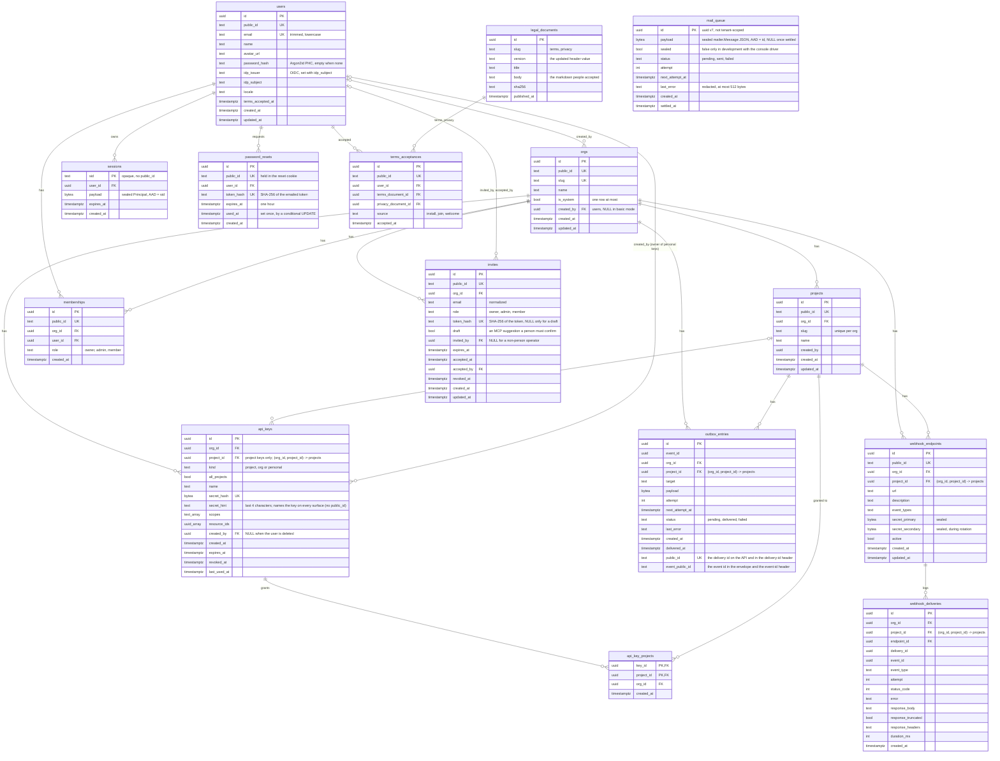

# schema

Postgres migrations for Othra, run by the app-agnostic `migrator` package
(goose). Files are templates: `{{.Schema}}`, `{{.TablePrefix}}`, `{{.Role}}`.
`Config.Schema` defaults to `public`; a non-empty `Config.Role` runs `SET ROLE`
on the migration connection.

Roles (`scripts/db/provision.sh`): migrations run as `othra_migrator` with
`SET ROLE othra_owner`, so `othra_owner` (NOLOGIN, BYPASSRLS) owns the schema,
every table, sequence and function, and `goose_db_version`. The app logs in as
`othra_service` (NOBYPASSRLS, no memberships, owns nothing), which gets
`SELECT, INSERT, UPDATE, DELETE` on tables, `USAGE` on sequences and `EXECUTE`
on functions through the owner's default privileges, read-only access to
`goose_db_version`, and no `CREATE` or `TEMP`. Functions are never executable by
`PUBLIC`. `scripts/db/verify.template.sql` checks all of this. Integration tests
get the same split from `pgtest.MigratedRLS` (`othra_test_owner`,
`othra_test_service`).



Every foreign key to `orgs`, `projects`, `api_keys`, `webhook_endpoints` and
`users` cascades on delete, except `orgs.created_by`, `api_keys.created_by`,
`invites.invited_by` and `invites.accepted_by`, which are set to NULL.

## Constraints and indexes

Rules the diagram can't show. Names omit `{{.TablePrefix}}`.

| Table                                                                   | Constraint / index                                                                              | Rule                                                                                                                                       |
| ----------------------------------------------------------------------- | ----------------------------------------------------------------------------------------------- | ------------------------------------------------------------------------------------------------------------------------------------------ |
| `orgs`                                                                  | `orgs_one_system` (unique, `WHERE is_system`)                                                   | at most one system org; it marks the instance as installed                                                                                 |
| `projects`                                                              | `UNIQUE (org_id, slug)`, `projects_org_id_id_key UNIQUE (org_id, id)`                           | slug unique per org; the pair is the target of org-scoped FKs                                                                              |
| `api_keys`, `outbox_entries`, `webhook_endpoints`, `webhook_deliveries` | `<table>_org_project_fkey`: `(org_id, project_id) → projects (org_id, id)`, `ON DELETE CASCADE` | a row's project always belongs to the row's org; a NULL `project_id` (org and personal keys) is allowed                                    |
| `api_keys`                                                              | `api_keys_kind_shape` (check)                                                                   | `project` keys have a `project_id` and no `all_projects`; `org` and `personal` keys have no `project_id`                                   |
| `api_keys`                                                              | `api_keys_created_by_fkey` (`ON DELETE SET NULL`)                                               | `created_by` is a real user; deleting the user keeps the key but clears the owner, and a personal key without an owner never authenticates |
| `api_keys`                                                              | `api_keys_personal_idx` (`WHERE kind = 'personal'`)                                             | lists one person's personal keys in an org                                                                                                 |
| `api_keys`                                                              | `api_keys_secret_hash_key` (unique)                                                             | keys are found by the hash of their secret                                                                                                 |
| `api_keys`                                                              | `api_keys_live_hint_key` (unique `(org_id, secret_hint)`, `WHERE revoked_at IS NULL`)           | a live key is named by its hint within its org; minting tries a new secret when the hint is taken; revoked keys may share one              |
| `api_key_projects`                                                      | FKs on `(org_id, key_id)` and `(org_id, project_id)`                                            | a key can only be granted projects of its own org                                                                                          |
| `outbox_entries`                                                        | `UNIQUE (org_id, event_id, target)`, status check                                               | one entry per event and target, per org                                                                                                    |
| `outbox_entries`                                                        | `outbox_entries_public_id_key` (unique)                                                         | a delivery is found by its public id; all entries of one event share `event_public_id`                                                     |
| `webhook_endpoints`                                                     | `webhook_endpoints_secondary_nonempty` (check)                                                  | the secondary secret is NULL or non-empty                                                                                                  |
| `users`                                                                 | `users_email_normalized` (check), `email` unique                                                | email is stored trimmed and lowercase                                                                                                      |
| `users`                                                                 | `users_idp_pair` (check), `users_idp_idx` (unique, `WHERE idp_issuer IS NOT NULL`)              | issuer and subject are set together and identify one user                                                                                  |
| `memberships`                                                           | `UNIQUE (org_id, user_id)`, role check                                                          | one membership per person per org                                                                                                          |
| `invites`                                                               | `invites_live_idx` (unique, `WHERE accepted_at IS NULL AND revoked_at IS NULL`)                 | one live invite per org and email; a re-invite updates that row                                                                            |
| `invites`                                                               | `invites_token_or_draft` (check), `token_hash` unique                                           | every invite but a draft has a token; tokens are found by their hash                                                                       |
| `invites`                                                               | `email` check                                                                                   | email is stored trimmed and lowercase                                                                                                      |
| `legal_documents`                                                       | `legal_documents_slug_version_key` (unique)                                                     | one snapshot per document version; built-in documents only (a custom terms or privacy URL keeps no history)                                |
| `terms_acceptances`                                                     | `terms_acceptances_user_idx`                                                                    | one person's acceptances, oldest first                                                                                                     |
| `mail_queue`                                                            | `mail_queue_settled_erased`, `mail_queue_pending_payload` (checks)                              | a pending row holds its payload; a sent or failed row holds none                                                                           |
| `mail_queue`                                                            | `mail_queue_due_idx` (`WHERE status = 'pending'`)                                               | the worker's claim of due mail                                                                                                             |
| `password_resets`                                                       | `token_hash` unique, `password_resets_user_idx` (`WHERE used_at IS NULL`)                       | tokens are found by their hash; a new request deletes the person's unused tokens                                                           |
| `sessions`                                                              | `sessions_expires_idx`, `sessions_user_idx`                                                     | sweep of expired rows; delete all sessions of a user                                                                                       |

## External migrations

Run another tool's migrations after ours on the same DB:

```go
schema.New(cfg).WithUpgrade("whatsmeow", meow.Upgrade).Up(ctx, db)
```

The external tool owns its tables under a reserved prefix; ours must not use it.
`MigrationsFS()` exposes the raw SQL for a guard test.

## Add a migration

1. `NNN_<name>.sql` at the next number, with a working `Down`.
2. Bump `VERSION`.
3. Add or update the `schema/entity` binding for the table.
4. In the same commit, update this README: the diagram (tables, columns,
   relationships) and the constraints table (new unique, check, partial or
   foreign-key rules).
